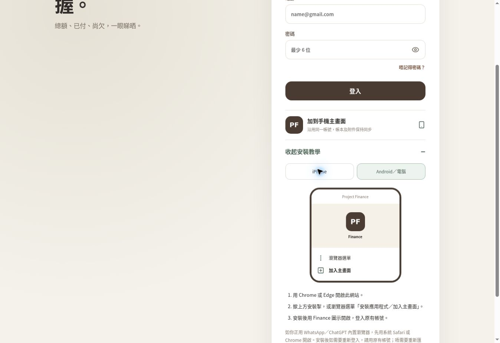
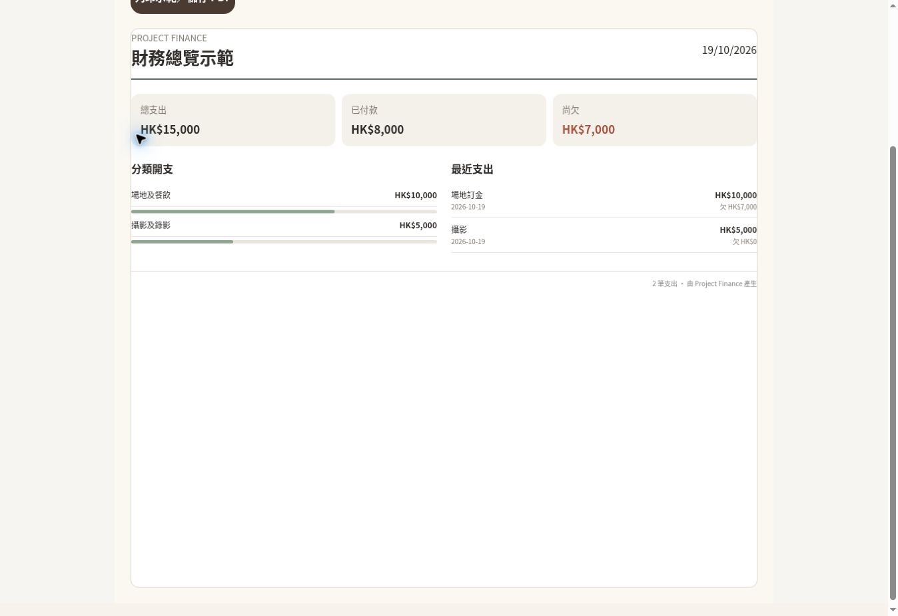

# Installable web app and PDF follow-up

19 October 2026. Shipped application commit: `420705dfc0c9ecd5d942e4afe255e801f6a2b654`.

## Delivered

- Standalone web app manifest, normal and maskable Android icons, Apple touch icon, and a root start URL with no account, invitation or authentication parameters.
- Reopenable installation instructions on login and account/project settings. Both iPhone and Android/desktop tabs use a small visual guide. The browser's native installation button is offered only when its install event is available.
- A service worker that caches five public recovery/icon assets only. Cloud data, auth responses, signed proof URLs, uploads, application HTML and POST requests are not cached. Network failures during navigation show a public recovery page. There is no offline ledger editing in this release.
- Income-disabled PDF summaries show total expenses, paid and outstanding only; enabling income restores a fourth metric. Existing income rows are not removed. The print script's closing tag is fixed.

## Verification

| Check | Evidence |
| --- | --- |
| Production installation UI | Browser opened login installation guide, switched iPhone/Android tabs and checked the icon loads at 192px |
| Published PWA assets | HTTP 200: manifest (application/manifest+json), worker (application/javascript), offline page (text/html), normal and maskable PNGs |
| Private data cache isolation | Node worker harness confirmed no interception of cross-origin Supabase, auth, signed attachments or POST data |
| Offline recovery | Worker harness simulated failed navigation and returned only the public offline page; online navigation stayed network-first |
| PDF income toggle | Production renderer iframe and separate print window showed HK$15,000 total, HK$8,000 paid and HK$7,000 outstanding; HK$20,000 income appeared only when enabled |
| Print launch | Button opened the separate rendered summary window successfully. Saving from the operating system's print dialog was not automated |
| Regression checks | Production build and 23 Node tests passed, including prior auth/payment/capture checks |

The real iPhone Safari installation, camera capture, exact Wallet/Octopus trigger and Android native installation prompt are still hardware checks. Chrome UI/manifest availability alone does not certify those devices. No database or account configuration was modified in this follow-up.

## Remaining native/platform work

This is an installable website using the existing account/backend. App Store and Google Play packages, native notification integration, store review, in-app subscriptions, advertising and billing have not been shipped.

Before enabling those, the owner must supply the relevant developer/store/provider accounts and app identifiers, approve any enrollment or service charges, and choose actual membership prices and benefits. Existing Free ledgers, collaboration, imports and exports remain usable. No paid service or enrollment was created.

SMTP delivery and Google OAuth provider credentials remain outside this follow-up's verification. They must not be described as fixed by the PWA or PDF changes.
