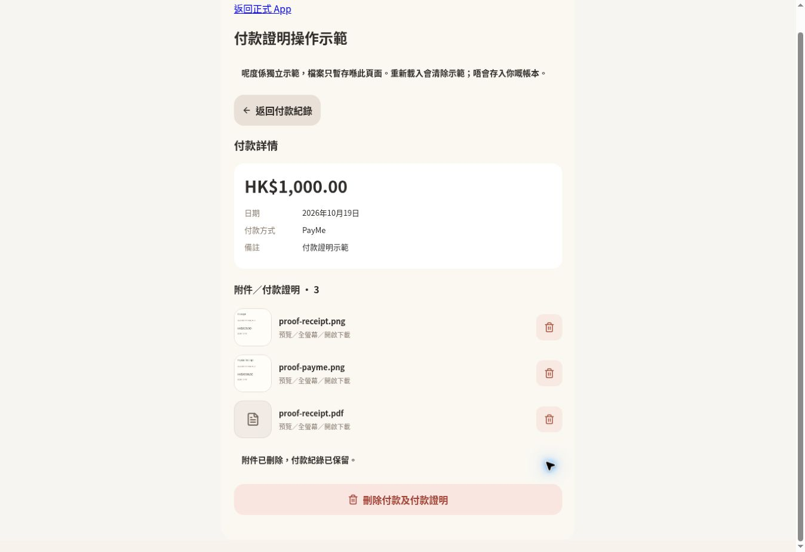
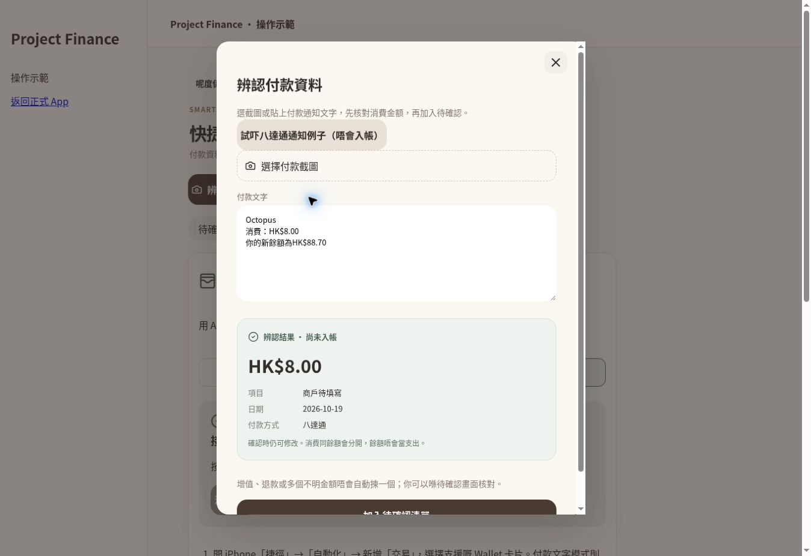

# Payment attachments and notification capture — 19 October 2026

Production: https://cng-finance.vercel.app/

Payment implementation: `994bd144afb9e266ddb6b4249b14e25f93437661`.
Notification capture and guided setup: `544c59df442c3408607ec657f4fea0f1040328a1`.

## Payment acceptance checks

| Requested check | Result and evidence |
| --- | --- |
| 1. Payment without attachment | Passed: authenticated live integration and deployed browser demo |
| 2. Payment with one image | Passed: live PNG upload, attachment row linked only by payment_id |
| 3. Payment with multiple images | Passed: live multi-image/PDF upload; browser selected four files |
| 4. Preview | Passed: local image and PDF full-screen browser previews; live signed file access |
| 5. Remove before submit | Passed: removed FPS thumbnail before submit, retained other local files |
| 6. Files exist after submit | Passed: live DB/Storage checks and browser history/detail |
| 7. Files persist after reload | Passed: fresh authenticated API reads and signed URLs; demo reload intentionally resets |
| 8. History shows attachments | Passed: browser displayed four-file count, three thumbnails and +1 |
| 9. Payment detail | Passed: amount, date, method, notes and four attachments displayed |
| 10. Delete attachment keeps Payment | Passed: live API check and browser demo reduced four attachments to three, keeping HK$1,000 payment |
| 11. Delete Payment cleans DB/files | Passed: real payment cascade, transactional cleanup queue, actual Storage cleanup worker; not only a mock |
| 12. Project isolation | Passed: authenticated outsider and cross-project parent checks |
| 13. iPhone Safari | Pending real device. Mobile CSS, safe areas, file selection and camera capture input are implemented; Chrome results do not certify iPhone camera/Safari |

The live integration runner returned 12 successful checks, including retry safety, missing-parent rejection, signed downloads, delete cascades and actual background file removal. It used generated fixture accounts/projects and was disabled after completion. Existing real counts stayed at 3 users, 23 payments, 2 attachments and 2 Storage objects.

Attachment deletion commits the DB delete/cleanup queue first and then attempts immediate Storage removal. The existing cleanup worker runs every ten minutes. Unregistered payment file paths are swept after one hour, with a shorter finalization window to avoid races. No direct SQL deletion of Storage metadata is used. The existing exactly-one-parent constraint remains; there is no new payment_attachments table.

## Uploaded video's transaction feature

Observed: an Octopus HK$8 consumption notification with HK$88.70 balance, followed by another app's transaction notification. The recording does not reveal the source app's automation or implementation.

Shipped:

- Shared browser/Edge parser selects labelled HK$8 spending, excluding the HK$88.70 balance. Top-ups, refunds, competing amounts and balance-only messages require review.
- Immediate result preview and a safe notification example in the actual screenshot/text capture screen.
- A three-step iPhone Shortcut setup with project-specific key generation/revocation, structured Wallet or text JSON, copy controls and an explicit pending-only test.
- The previous invalid `client.co` ingress URL is fixed to the actual project `supabase.co` URL.
- The existing capture endpoint accepts `{text, request_id}` as well as prior structured Wallet inputs. Text mode requires a retry UUID and does not automatically create an expense.

Actual endpoint tests returned 201 twice with the same draft ID for the same request UUID; the DB contained one pending HK$8 Octopus draft and zero expenses. Ambiguous text returned 400 without a draft. The generated test project was archived and its draft dismissed after verification; no real payment, attachment or Storage object was modified. Permanent removal of this synthetic project encountered an MCP request-state error, so the reversible archive was used. Its scoped key is unusable while the project is archived.

Deployed browser demo passed: example → HK$8 preview → pending list → prefilled amount/method → explicit confirmation → pending count decreases. The demo does not access production data. The test button's live HTTP/DB path was verified separately above.

## Verification and limits

`npm run build` passed. Eighteen Node checks passed across auth state, payment failure/retry handling, parser and Shortcut payload validation.

The website supplies the receiving, parsing, pending-review and bookkeeping flow. It cannot install a personal automation on the user's iPhone. Apple documents Wallet transaction triggers, but the recording's exact Octopus notification trigger and real iPhone Safari/camera flow remain unverified on hardware. A signed one-tap .shortcut installer is not provided by this release.

Prior charts, collaboration, CSV sample/import/export, account/project images, visual onboarding and print-to-PDF remain available. Native iOS/Android packaging/store submission, native notification integration, paid subscriptions/in-app billing and ad SDKs remain separate platform work requiring developer/provider accounts and device/store testing. Google provider credentials and actual SMTP delivery are not certified by this payment/capture release. These are not represented as completed features or paid plan restrictions.
