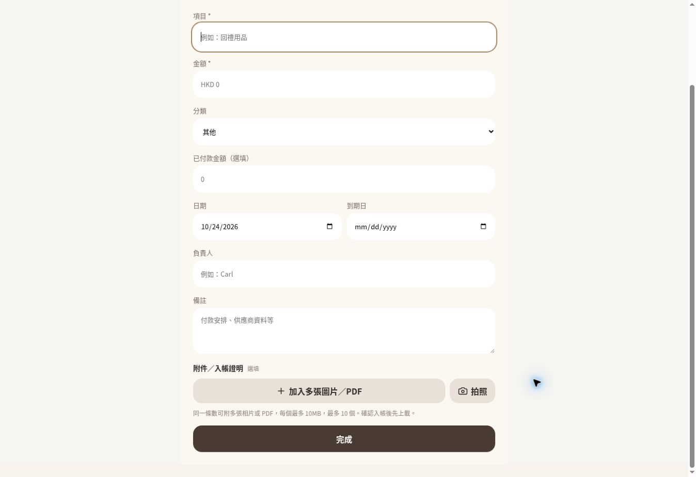

# Multiple receipts and evidence — release verification

Code release: d1f76f811fa3a245734ed9f7383deacae6cb9dd0. GitHub Vercel status: success, Deployment has completed. Production: https://cng-finance.vercel.app/.

Manual expense creation/editing, quick entry and pending-draft confirmation accept up to ten optional image/PDF evidence files. One amount may have several evidence files without OCR. The separate multiple-receipt flow creates one item from several paid purchases, retaining each merchant/payment/proof; later purchases append to both total and paid amounts.

- Node suite: 32 passed, 1 existing environment-dependent sync test skipped. Production build and git diff whitespace checks passed.
- Live authenticated Supabase + private Storage: eight checks passed, including one expense/three payments, image/PDF mapping, idempotent retry, exact-cent append, fresh-client reload and signed download, outsider isolation, proof deletion retaining payment, multiple expense evidence surviving reload.
- SQL rollback tests verified atomic rejection, duplicate retry, wrong project/category and outsider rejection. Synthetic API fixtures cleaned; baseline unchanged: 3 users, 23 expenses, 23 payments, 2 attachment rows and 2 Storage objects.
- Temporary integration runner is disabled: version 6, JWT required, response 410.
- Independent review findings fixed: OCR never overwrites manual values/date; internal navigation consults pending-payment guard; failed draft dismissal remains retryable; incomplete RPC responses cannot silently discard evidence.
- Deployed UI observed at `?demo=receipts` and `?demo=evidence`. Manual title/amount entry worked. Evidence picker reported `isMultiple: true`.
- Browser file chooser `setFiles` timed out in the cloud automation on two attempts. No browser upload-completion, local-preview/removal or real iPhone Safari/camera certification is claimed. Actual API/Storage uploads and reload persistence passed independently.

